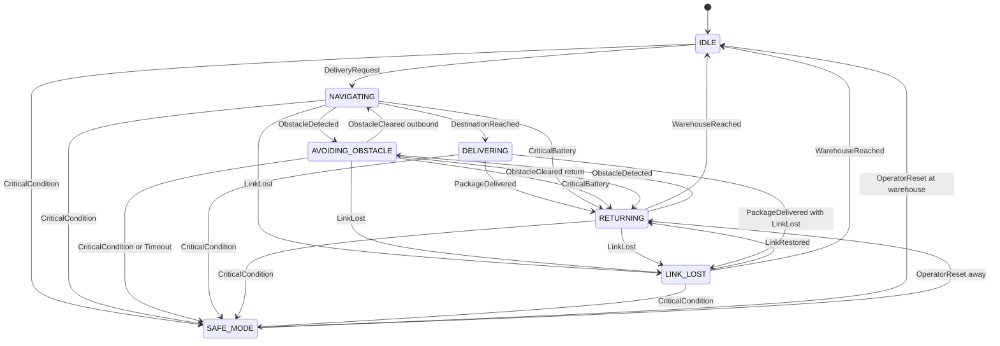

# Task 3 – State Modelling & Transition Verification

## 3.1 States

| ID | State | Meaning | Entry condition | Exit condition |
|---|---|---|---|---|
| S1 | IDLE | Powered, parked at warehouse, waiting for a request | Power-on, or WarehouseReached, or SAFE_MODE reset at warehouse | Valid DeliveryRequest, or critical condition |
| S2 | NAVIGATING | Driving to the destination | Valid DeliveryRequest, or ObstacleCleared (outbound) | DestinationReached, ObstacleDetected, CriticalBattery, critical condition, LinkLost |
| S3 | AVOIDING_OBSTACLE | Navigation suspended, manoeuvring around obstacle | ObstacleDetected in NAVIGATING or RETURNING | ObstacleCleared, CriticalBattery, critical condition, LinkLost, AvoidanceTimeout |
| S4 | DELIVERING | Stationary at the destination, handing over the batch | DestinationReached from NAVIGATING (door closed, no protection active) | PackageDelivered, critical condition |
| S5 | RETURNING | Travelling back to the warehouse | PackageDelivered, CriticalBattery, ObstacleCleared (return), LinkRestored, reset away from warehouse | WarehouseReached, ObstacleDetected, critical condition, LinkLost |
| S6 | SAFE_MODE (CR-01) | Robot stopped (unless on a crossing, see C-09), chamber protected, operator alerted | Critical thermal, EmergencyBattery or fault, AvoidanceTimeout | Authorised OperatorReset after conditions clear |
| S7 | LINK_LOST | No link; autonomous safe return, no new deliveries | LinkLost (30 s without heartbeat) | LinkRestored, WarehouseReached, critical condition |

## 3.2 Events / conditions

| ID | Event | Description |
|---|---|---|
| E1 | DeliveryRequest | Authenticated, authorised and validated request with destination |
| E2 | DestinationReached | Robot position within the destination radius |
| E3 | ObstacleDetected | Obstacle sensor reports an object on the path |
| E4 | ObstacleCleared | Path free for the configured time |
| E5 | PackageDelivered | Clinic confirms handover, chamber door closed again |
| E6 | WarehouseReached | Robot docked at the warehouse |
| E7 | CriticalBattery | Battery ≤ 20 % |
| E8 | CriticalCondition | Any of: EmergencyBattery (≤ 5 %), battery or chamber temperature above the critical threshold, critical fault |
| E9 | LinkLost | No heartbeat for 30 s |
| E10 | LinkRestored | Heartbeat valid again |
| E11 | OperatorReset | Authorised operator command to leave SAFE_MODE |
| E12 | AvoidanceTimeout | Obstacle manoeuvre lasting more than 120 s |

**State vs event:** a *state* is a condition the robot stays in over a period of time (it has duration, e.g. NAVIGATING) and decides which events are accepted. An *event* is an instantaneous occurrence or condition change (e.g. ObstacleDetected) with no duration. The event only causes a transition when the current state and its guard allow it.

**Event priority (resolves simultaneous events):** E8 > E7 > E9 > E3 > E2 > E1.

## 3.3 State Transition Table

| T-ID | Current State | Event [guard] | Next State | Req. ID | Valid? | Verification evidence |
|---|---|---|---|---|---|---|
| T01 | IDLE | DeliveryRequest [authenticated ∧ authorised ∧ valid] | NAVIGATING | FR-01, FR-02, FR-03 | Valid | TC-01, TC-02, TC-03 |
| T02 | NAVIGATING | ObstacleDetected | AVOIDING_OBSTACLE | FR-04 | Valid | TC-06, simulation trace |
| T03 | AVOIDING_OBSTACLE | ObstacleCleared [mission = OUTBOUND] | NAVIGATING | FR-04 | Valid | TC-06 |
| T04 | NAVIGATING | DestinationReached [door closed ∧ ¬protection active] | DELIVERING | FR-04, SR-02 | Valid | TC-06, TC-11 |
| T05 | DELIVERING | PackageDelivered [no LinkLost latched] | RETURNING | FR-06 | Valid | TC-01 trace |
| T06 | RETURNING | WarehouseReached | IDLE | FR-03, FR-06 | Valid | TC-08 |
| T07 | NAVIGATING | CriticalBattery | RETURNING | FR-06 | Valid | TC-08 |
| T08 | AVOIDING_OBSTACLE | CriticalBattery | RETURNING (mission aborted) | FR-06 | Valid (added after verification, see 3.5d) | TC-08 |
| T09 | DELIVERING | CriticalBattery | DELIVERING (flag latched; return follows T05) | FR-06, SR-02 | Valid (added) | TC-08 |
| T10 | RETURNING | ObstacleDetected | AVOIDING_OBSTACLE (mission = RETURN) | FR-04 | Valid (added) | TC-06 |
| T11 | AVOIDING_OBSTACLE | ObstacleCleared [mission = RETURN] | RETURNING | FR-04 | Valid (added) | TC-06 |
| T12 | IDLE | CriticalCondition | SAFE_MODE | FR-05 | Valid | TC-07 |
| T13 | NAVIGATING | CriticalCondition | SAFE_MODE | FR-05 | Valid | TC-07 |
| T14 | AVOIDING_OBSTACLE | CriticalCondition | SAFE_MODE | FR-05 | Valid | TC-07 |
| T15 | DELIVERING | CriticalCondition | SAFE_MODE | FR-05 | Valid | TC-07 |
| T16 | RETURNING | CriticalCondition | SAFE_MODE | FR-05 | Valid | TC-07 |
| T17 | SAFE_MODE | OperatorReset [authorised ∧ cleared ∧ at warehouse] | IDLE | FR-01, FR-05 | Valid | TC-07, TC-15 |
| T18 | SAFE_MODE | OperatorReset [authorised ∧ cleared ∧ ¬at warehouse] | RETURNING | FR-05 | Valid | TC-07 |
| T19 | NAVIGATING | LinkLost | LINK_LOST | SR-03 | Valid | TC-09 |
| T20 | AVOIDING_OBSTACLE | LinkLost | LINK_LOST (mission aborted) | SR-03 | Valid | TC-09 |
| T21 | RETURNING | LinkLost | LINK_LOST | SR-03 | Valid | TC-09 |
| T22 | DELIVERING | LinkLost | DELIVERING (flag latched; T26 follows) | SR-03 | Valid | TC-09 |
| T23 | LINK_LOST | LinkRestored [¬at warehouse] | RETURNING | SR-03 | Valid | TC-09 |
| T24 | LINK_LOST | WarehouseReached | IDLE | SR-03 | Valid | TC-09 |
| T25 | LINK_LOST | CriticalCondition | SAFE_MODE | FR-05, SR-03 | Valid | TC-07, TC-09 |
| T26 | DELIVERING | PackageDelivered [LinkLost latched] | LINK_LOST | SR-03 | Valid | TC-09 |
| T27 | IDLE | LinkLost | IDLE (no new request can be accepted) | SR-03 | Valid | TC-09 |
| T28 | SAFE_MODE | LinkLost | SAFE_MODE (beacon only) | SR-03, FR-05 | Valid | TC-09 |
| T29 | AVOIDING_OBSTACLE | AvoidanceTimeout | SAFE_MODE (operator alerted) | FR-04, FR-05 | Valid (added) | TC-06 |
| X01 | IDLE | DestinationReached / any start-delivery | DELIVERING | FR-03, SR-02 | **INVALID** – must not exist | TC-16 (expected: ignored, logged) |
| X02 | AVOIDING_OBSTACLE | DestinationReached | DELIVERING | FR-04, SR-02 | **INVALID** – must not exist | TC-06, TC-16 |
| X03 | IDLE | DeliveryRequest [¬authenticated ∨ ¬authorised] | NAVIGATING | FR-01 | **INVALID** – rejected, stays IDLE | TC-02, TC-03 |
| X04 | SAFE_MODE or LINK_LOST | DeliveryRequest | NAVIGATING | SR-03, FR-05 | **INVALID** – rejected | TC-15, TC-09 |
| X05 | RETURNING | DeliveryRequest | NAVIGATING | FR-02 | **INVALID** – rejected (not IDLE) | TC-16 |

## 3.4 Extension with Safe Mode (CR-01) and LINK_LOST

| Existing state | May enter SAFE_MODE? | May enter LINK_LOST? | Decision / reason |
|---|---|---|---|
| IDLE | Yes (T12) – the chamber may still be hot or the battery low while parked | No (T27) – stays IDLE, no request can arrive anyway | Nothing to abort |
| NAVIGATING | Yes (T13) | Yes (T19) | Autonomous return is safer than continuing without supervision |
| AVOIDING_OBSTACLE | Yes (T14) | Yes (T20) | Mission aborted, robot returns |
| DELIVERING | Yes (T15) | **Deferred** (T22, T26) – handover is finished first, then LINK_LOST | Aborting a handover leaves the batch in an undefined state |
| RETURNING | Yes (T16) | Yes (T21) | Already heading to the warehouse |
| SAFE_MODE | – | No (T28) – SAFE_MODE has priority | Safety first |
| LINK_LOST | Yes (T25) | – | Critical condition overrides |

Interpretation note: "critical battery" in FR-05 / CR-01 is the **emergency level (5 %)**. The ≤ 20 % **CriticalBattery** in the scenario triggers the return trip (FR-06), not Safe Mode.

## 3.5 Verifier investigation (looking for behavioural problems)

**(a) Can IDLE → DELIVERING happen?**
In the correct model: **no**. No row T01–T29 leaves IDLE for DELIVERING. It could occur only through an implementation or design error, for example an unguarded handler "DestinationReached → DELIVERING" that fires in every state (X01), or a corrupted position flag. This would violate **FR-03** (never deliver directly from IDLE) and **SR-02**. Detection: a runtime monitor for the invariant ¬(previous = IDLE ∧ next = DELIVERING). Test: TC-16.

**(b) What if AVOIDING_OBSTACLE has no transition back?**
The robot is stuck (a deadlock / liveness failure). It **cannot deliver**, which is safe in itself, but the mission never completes, the battery drains while the chamber needs power, and the operator is not told. Fix: T03, T11 (ObstacleCleared) plus T29 (AvoidanceTimeout of 120 s → SAFE_MODE with alert).

**(c) Can AVOIDING_OBSTACLE → DELIVERING occur?**
Not in the correct model. It can happen when DestinationReached fires while the robot is manoeuvring near the destination (X02). This would violate "never deliver while handling an obstacle" (**SR-02**, FR-04). Correct behaviour: DestinationReached is **ignored (deferred)** in AVOIDING_OBSTACLE; after ObstacleCleared (T03) the robot is NAVIGATING and T04 applies.

**(d) CriticalBattery in AVOIDING_OBSTACLE or DELIVERING (missing transition)?**
- *AVOIDING_OBSTACLE:* with no transition the event is lost. The robot resumes, continues to the destination, delivers and runs out of power far from the warehouse, so the chamber loses power and the batch is spoiled (FR-06 violated). Fix: **T08**.
- *DELIVERING:* with no transition the behaviour is undefined (event ignored or an unexpected state change). Decision: **T09**, latch the flag, finish the short handover, then T05 sends the robot to RETURNING. If the level reaches 5 % or a thermal alarm occurs, T15 → SAFE_MODE.

**Other problems found**
1. RETURNING had no obstacle handling → added T10 / T11 and the `mission` history guard (without it ObstacleCleared would wrongly resume NAVIGATING outward).
2. Simultaneous events (e.g. ObstacleDetected and CriticalBattery) were non-deterministic → event priority in 3.2.
3. SAFE_MODE had no exit → T17 / T18 require an **authorised** operator (FR-01).
4. Commands received in SAFE_MODE, LINK_LOST or RETURNING were unspecified → X04, X05.
5. DELIVERING + LinkLost would have aborted a handover → deferred (T22, T26).
