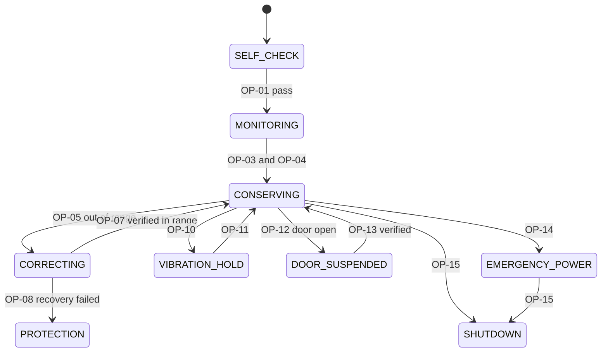

# Task 4 – Operation Identification & Operation Schema (Conservation Chamber)

## 4.1 Operations (18)

| OP-ID | Operation | What it does |
|---|---|---|
| OP-01 | RunPowerOnSelfCheck | Tests every essential sensor at power-on |
| OP-02 | SampleSensors | Reads temperature, humidity, vibration, door and power sensors periodically |
| OP-03 | LoadBatchProfile | Reads batch ID and temperature/humidity limits from the batch label |
| OP-04 | StartActiveConservation | Starts regulation when door closed and profile loaded |
| OP-05 | CorrectTemperature | Drives heating/cooling to bring temperature back in range |
| OP-06 | CorrectHumidity | Drives humidifier/dehumidifier to bring humidity back in range |
| OP-07 | VerifyRecovery | Compares sensor readings with the profile within the recovery period |
| OP-08 | ActivateProtectionResponse | Starts protection mode after failed recovery |
| OP-09 | ReduceLightExposure | Dims or shuts internal light / shading |
| OP-10 | SuspendRiskyActivities | Stops risky actions when vibration exceeds the threshold |
| OP-11 | ResumeAfterStabilisation | Restarts suspended activities after vibration stays low for 60 s |
| OP-12 | SuspendOnDoorOpen | Suspends normal operation when the door opens during conservation |
| OP-13 | ResumeAfterVerification | Resumes only after door closed and conditions and sensors verified |
| OP-14 | SwitchToEmergencyPower | Moves the chamber to emergency power on power loss |
| OP-15 | RecordIncidentAndShutdown | Logs the incident and shuts the chamber down safely if no emergency power |
| OP-16 | AuthoriseBatchRemoval | Allows removal only when chamber is safe and no protection response is active |
| OP-17 | AlertOperator | Sends an alert to Mission Control |
| OP-18 | LogChamberEvent | Writes a timestamped event record |

## 4.2 Operation Schemas (9)

### OP-01 RunPowerOnSelfCheck
| Field | Content |
|---|---|
| Description | Tests all essential sensors (temperature, humidity, vibration, door, power) and actuators at power-on |
| Inputs | Power-on signal |
| Outputs | Self-check result (PASS / FAIL, failed sensor list) |
| Reads | Sensor self-test registers, last stored calibration |
| Changes | Chamber state; self-check flag |
| Sends/Alerts | Alert to operator if FAIL |
| Assumes | Chamber powered; state = OFF |
| Result | PASS → state = MONITORING; FAIL → state stays SELF_CHECK, no monitoring, alert sent, event logged |

### OP-03 LoadBatchProfile
| Field | Content |
|---|---|
| Description | Loads batch identity and allowed temperature/humidity limits |
| Inputs | Batch ID / label data |
| Outputs | Active profile (T_min, T_max, H_min, H_max, recovery period) |
| Reads | Batch label, profile database |
| Changes | `Profile_Loaded`, active limits |
| Sends/Alerts | Alert if the label is unreadable or the profile unknown |
| Assumes | State = MONITORING; batch placed inside |
| Result | `Profile_Loaded = TRUE` and limits valid; otherwise conservation cannot start |

### OP-04 StartActiveConservation
| Field | Content |
|---|---|
| Description | Starts active temperature/humidity regulation |
| Inputs | Start request |
| Outputs | Conservation status |
| Reads | Door sensor, `Profile_Loaded`, current temperature and humidity |
| Changes | State MONITORING → CONSERVING; actuators on |
| Sends/Alerts | Status to Mission Control |
| Assumes | `Door_Closed ∧ Profile_Loaded ∧ self-check PASS` |
| Result | State = CONSERVING; otherwise the request is refused and logged |

### OP-05 CorrectTemperature
| Field | Content |
|---|---|
| Description | Corrects out-of-range temperature using heater/cooler |
| Inputs | Out-of-range event |
| Outputs | Actuator command (heat/cool, power level) |
| Reads | Temperature sensor(s), profile limits, recovery timer |
| Changes | Actuator setting; state CONSERVING → CORRECTING; starts recovery timer |
| Sends/Alerts | Warning to operator if correction exceeds half the recovery period |
| Assumes | State = CONSERVING; `T < T_min ∨ T > T_max`; actuator healthy |
| Result | Command issued. **Success is not assumed**: it is confirmed by OP-07 from sensor readings |

### OP-08 ActivateProtectionResponse
| Field | Content |
|---|---|
| Description | Puts the chamber in protection mode after failed recovery |
| Inputs | Recovery timeout from OP-07 |
| Outputs | Protection status, light-reduction command |
| Reads | Recovery timer, sensors |
| Changes | State CORRECTING → PROTECTION; `Protection_Active = TRUE`; calls OP-09 |
| Sends/Alerts | Alert to operator; `CriticalCondition` to the robot if the temperature exceeds the critical threshold (links to T12–T16) |
| Assumes | State = CORRECTING; recovery period expired; values still out of range |
| Result | `Protection_Active = TRUE`, light reduced, operator alerted, batch removal blocked, event logged |

### OP-12 SuspendOnDoorOpen
| Field | Content |
|---|---|
| Description | Suspends normal operation when the door opens during conservation |
| Inputs | Door-open signal |
| Outputs | Suspension status |
| Reads | Door sensor, robot state |
| Changes | State CONSERVING → DOOR_SUSPENDED; regulation paused (cold-hold); `Normal_Op = FALSE` |
| Sends/Alerts | Alert and event to Mission Control; if the robot is not DELIVERING, a constraint violation (C-10) is raised |
| Assumes | State = CONSERVING; `Door_Open = TRUE` |
| Result | `Normal_Op = FALSE` until OP-13 succeeds |

### OP-13 ResumeAfterVerification
| Field | Content |
|---|---|
| Description | Resumes normal operation after a door event |
| Inputs | Door-closed signal |
| Outputs | Verification result |
| Reads | Door sensor, temperature, humidity, vibration, self-test of essential sensors |
| Changes | State DOOR_SUSPENDED → CONSERVING (or CORRECTING if out of range) |
| Sends/Alerts | Alert if verification fails |
| Assumes | State = DOOR_SUSPENDED; `Door_Closed = TRUE` |
| Result | Resume only if `Door_Closed ∧ T,H in range ∧ all essential sensors OK`; otherwise remain suspended |

### OP-14 SwitchToEmergencyPower
| Field | Content |
|---|---|
| Description | Switches the chamber to emergency power on power loss |
| Inputs | Power-loss signal |
| Outputs | Power-source status |
| Reads | Main power sensor, emergency power availability and level |
| Changes | Power source; state CONSERVING → EMERGENCY_POWER |
| Sends/Alerts | Alert to operator ("running on emergency power") |
| Assumes | `Main_Power_Lost ∧ Emergency_Power_Available` |
| Result | Chamber powered within 1 s (SR-04) and the bus voltage is confirmed by sensor; otherwise OP-15 is called |

### OP-16 AuthoriseBatchRemoval
| Field | Content |
|---|---|
| Description | Allows the door to be opened for batch handover |
| Inputs | Handover request from DELIVERING state |
| Outputs | Unlock permission |
| Reads | Chamber state, `Protection_Active`, temperatures, robot state |
| Changes | Door lock released; `Batch_Removal_Authorised = TRUE` |
| Sends/Alerts | Refusal reason to operator |
| Assumes | Chamber safe ∧ ¬`Protection_Active` ∧ robot state = DELIVERING |
| Result | Door unlocked only under these conditions; otherwise it stays locked and the refusal is logged |

## 4.3 Operations changing the chamber state and the link to the robot model (Task 3)

| Operation | Chamber state change | Effect on the robot model (Task 3) |
|---|---|---|
| **OP-12 SuspendOnDoorOpen** (door opened during conservation) | CONSERVING → DOOR_SUSPENDED | If robot = NAVIGATING, AVOIDING_OBSTACLE or RETURNING, the door must be closed (C-10); an open door is a violation, alert raised and `CriticalCondition` → SAFE_MODE (T13, T14, T16). If robot = DELIVERING, the open door is expected only with `Batch_Removal_Authorised` (C-11). While DOOR_SUSPENDED the robot must not enter DELIVERING (T04 guard `door closed`) |
| **OP-08 ActivateProtectionResponse** (recovery failed) | CORRECTING → PROTECTION | `Protection_Active = TRUE` blocks T04 and OP-16. If the temperature is above the critical threshold, `CriticalCondition` → SAFE_MODE from any state (T12–T16, T25) within 3 s (C-12) |

## 4.4 Operations whose postcondition must be verified by sensors

1. **OP-05 CorrectTemperature (verified by OP-07).** Issuing a heat/cool command does not prove that the temperature has returned to range. The actuator can be stuck or too weak, the sensor can drift, and the thermal mass of the chamber causes delay. Assuming success would let a batch stay out of range unnoticed. The postcondition is therefore `T_min ≤ T ≤ T_max` **read from sensors** (and from a second sensor) within the recovery period; failure leads to OP-08.
2. **OP-13 ResumeAfterVerification.** The "door closed" signal comes from a switch that can be stuck or bounce, and the batch may have warmed up while the door was open. Resuming on the closed signal alone could restart conservation with an ajar door or a warm batch. Resumption requires current readings showing door closed, temperature/humidity in range and all essential sensors healthy.
